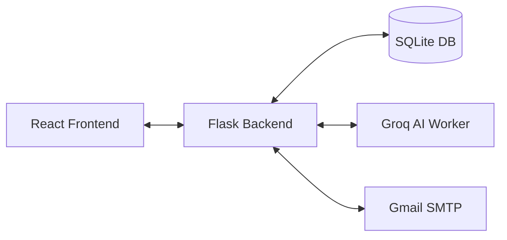

# Outreach Tool 🚀

A powerful, local-first personal email outreach tool that generates unique, human-sounding personalized emails using the Groq API and sends them via Gmail SMTP with automated resume attachments.

**Single-user • Localhost-only • Privacy-focused**
---
## Demo

<video width="630" height="300" src="https://github.com/user-attachments/assets/da78db07-0ccb-463e-ad02-e3029b84d825"></video>


---

## ✨ Key Features

- **Parallel Email Generation**: Leverages multi-threading (`ThreadPoolExecutor`) to generate multiple personalized drafts simultaneously, significantly reducing wait times.
- **Multi-Key Round-Robin**: Supports up to 3 Groq API keys, used in rotation to spread load across rate limits.
- **Live Progress Tracking**: Real-time visual feedback via a dedicated progress bar UI. Monitor successes, failures, and individual error messages as they happen.
- **Gmail SMTP Integration**: Securely send emails using Gmail App Passwords. Supports automated resume attachments (PDF) and threaded follow-ups.
- **Intelligent Personalization**: Powered by Groq's high-speed inference (Llama 3), tailoring every email to the lead's profile and your custom campaign goal.
- **Context-Aware Follow-ups**: Paste a recruiter's reply and the follow-up adapts to it (no reply, check back later, no openings). Follow-ups are sent as threaded replies.
- **Automatic Reply Detection**: Every 10 minutes the inbox monitor finds replies to your emails (matched by email thread, or by sender), classifies them with AI (interested / check back / no openings / rejection / interview) and records them. It also catches bounces and out-of-office replies. Statuses you set by hand are never overwritten.
- **Follow-up Sequences**: Per campaign, set up to 3 automatic follow-ups (e.g. +4 days, +7 days). Each step is drafted for everyone who hasn't replied, threaded onto the original email, and either queued for your review or sent automatically. Any reply stops the sequence for that person.
- **Scheduled Sending**: Schedule a campaign for later, restrict sending to working hours / weekdays, set a daily limit (with an optional warm-up ramp for new Gmail accounts), and stop a send at any time. Sends pause and resume automatically around those limits, and a send cut off by a backend restart picks up where it left off.
- **CSV / Excel Import**: Import contacts (`.csv` or `.xlsx`) with company, role and personal notes; the AI uses them to personalise each email.
- **Pipeline Board**: A Kanban view of every contact by reply status, with drag-and-drop status changes.
- **Lightweight CRM**: Search contacts, see every email and reply per contact, check-back reminders, blocked domains, and re-engagement candidates.
- **Safe Sending**: Duplicate-send protection, automatic stop on Gmail login failure, retry for failed emails, and progress that survives a backend restart.
- **Local-First**: Your leads, drafts and credentials stay on your machine in a SQLite database and `backend/config.json`. Note: credentials are stored **unencrypted** in that file — keep it private.

---

## 🛠️ Tech Stack

- **Backend**: Python 3.11+, Flask (REST API), SQLite (Database), APScheduler.
- **Frontend**: React 18, Vite, Tailwind CSS v3, React Router v6.
- **AI Inference**: Groq SDK — `openai/gpt-oss-20b` by default, falling back to `openai/gpt-oss-120b` and `qwen/qwen3.8-27b` (Groq shut down its Llama models for free accounts on 2026-08-16). Models are configurable in **Settings → AI Models**, which lists what your key can use.
- **Automation**: Multi-threaded generation workers; send/generation progress persisted in SQLite.

---

## 📋 Prerequisites

- **Python**: 3.11 or higher.
- **Node.js**: 18.x or higher.
- **Gmail Account**: Must have [2-Step Verification](https://myaccount.google.com/security) enabled.
- **Groq API Key**: At least one key from the [Groq Console](https://console.groq.com/keys). (Up to 3 recommended for high-volume tasks).

---

## 🚀 Getting Started

### 1. Clone the Repository
```bash
git clone https://github.com/SaraswatSahoo/outreach-tool.git
cd outreach-tool
```

### Quick start

```bash
./start.sh   # creates the venv, installs dependencies, starts backend + frontend
```

Or set each part up manually:

### 2. Backend Setup
```bash
cd backend
python -m venv venv
# Windows:
.\venv\Scripts\activate
# Linux/macOS:
source venv/bin/activate

pip install -r requirements.txt
python app.py
```
*The server will start on `http://localhost:5000`.*

### 3. Frontend Setup
```bash
cd ../frontend
npm install
npm run dev
```
*The application will be available at `http://localhost:5173`.*

---

## ⚙️ Configuration

No manual file editing is required. All configuration is handled through the application UI:

1.  **Profile Page**: Fill in your personal details (Name, College, Skills, Bio) and upload your Resume (PDF). Don't forget to parse your resume. This data is used by the AI to personalize your outreach mails.
2.  **Settings Page**:
    - **Gmail**: Enter your Gmail address and **App Password** (see below).
    - **API Keys**: Add up to 3 Groq API keys from the [Groq Console](https://console.groq.com/keys). Requests rotate across them. Keys are never sent back to the browser once saved.
    - **Delay**: Configure the send delay (20–90s, default 60s) to stay well within Gmail's sending limits.
    - **Blocked Domains**: Domains you never want to email (also manageable from Search and the contact drawer).

### 🔑 Getting a Gmail App Password
1.  Go to [Google Account Security](https://myaccount.google.com/security).
2.  Navigate to **2-Step Verification** > **App Passwords**.
3.  Generate a new app password for "Mail".
4.  Copy the 16-character code into the Settings page.

---

## 🏗️ Architecture Overview

### CSV / Excel format

Any CSV or `.xlsx` file with a header row works (for Excel, the first sheet is used); you map the columns when importing. Recognised automatically: `email`, `name`, `company`, `role`/`title`, `notes`. Example:

```csv
email,name,company,role,notes
jane@acme.com,Jane Doe,Acme Robotics,CTO,Gave a talk on SLAM at PyCon 2026
```

### Data Flow


- **Frontend**: A SPA built with React that polls the backend for real-time progress updates during generation.
- **Backend**: A Flask application that manages a thread pool for parallel AI requests.
- **Database**: SQLite stores all lead information, campaign history, and email templates.
- **In-Memory Progress**: Generation status is tracked in real-time, allowing the UI to show instant feedback.

---

## 🧪 Development

```bash
# Backend: lint, format check, tests (tests use a throwaway database; no network calls)
cd backend && pip install -r requirements-dev.txt
ruff check . && ruff format --check . && python -m pytest

# Frontend lint + production build
cd frontend && npm run lint && npm run build
```

CI runs both on every push (`.github/workflows/ci.yml`).

Backend layout: `app.py` (app factory) · `routes/` (one Flask blueprint per area) · `jobs.py` (background generation/sending) · `sending.py` (starting send jobs) · `automation.py` (scheduled sends + follow-up sequences) · `scheduling.py` (send window / daily cap) · `ai_generator.py` (prompts + Groq) · `inbox_monitor.py` + `reply_detector.py` (IMAP bounce/OOO/reply detection).

Background schedule (while the backend runs): inbox check every 10 min, scheduled sends every minute, follow-up sequences every 15 min. Automation only works while `python app.py` is running.

Environment variables: `FLASK_DEBUG` (default `1`), `PORT` (default `5000`), and `OUTREACH_DB_PATH` / `OUTREACH_CONFIG_PATH` / `OUTREACH_UPLOAD_DIR` to relocate data files. They can also go in `backend/.env` — copy `backend/.env.example`.

Database changes are versioned migrations in `db.py` (`MIGRATIONS`); they run automatically at startup, and older databases are upgraded in place.

---

## 🤝 Contributing

Contributions are welcome! Please feel free to submit a Pull Request or open an issue for bugs and feature requests.

## 📄 License

This project is licensed under the MIT License.
